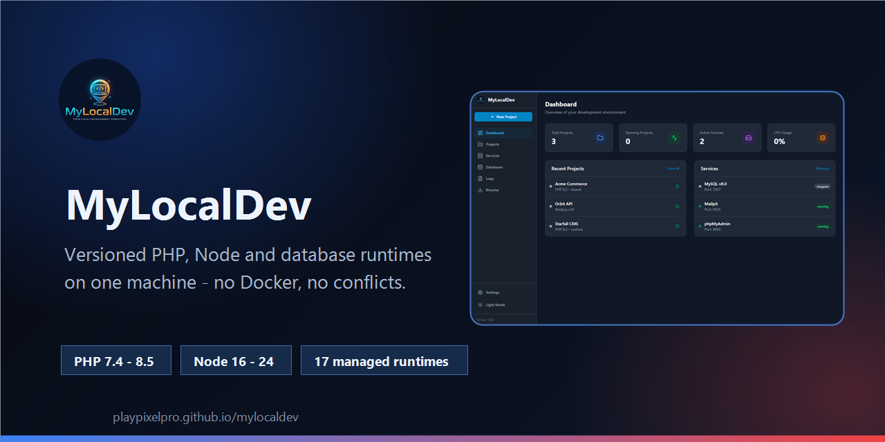
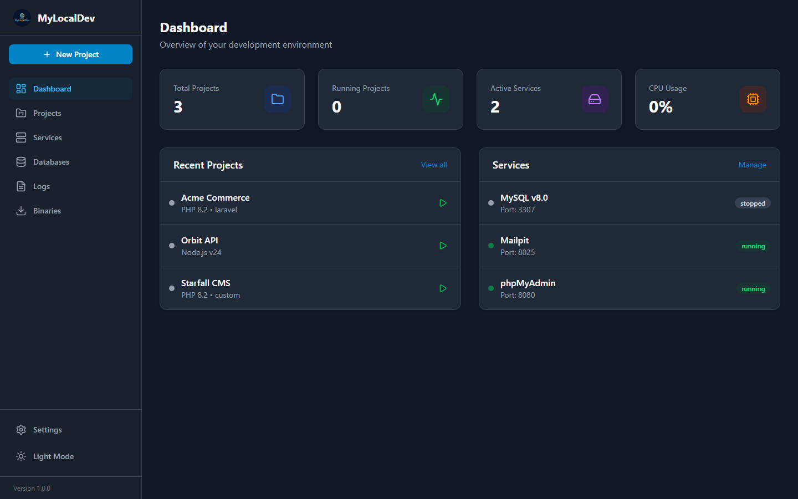
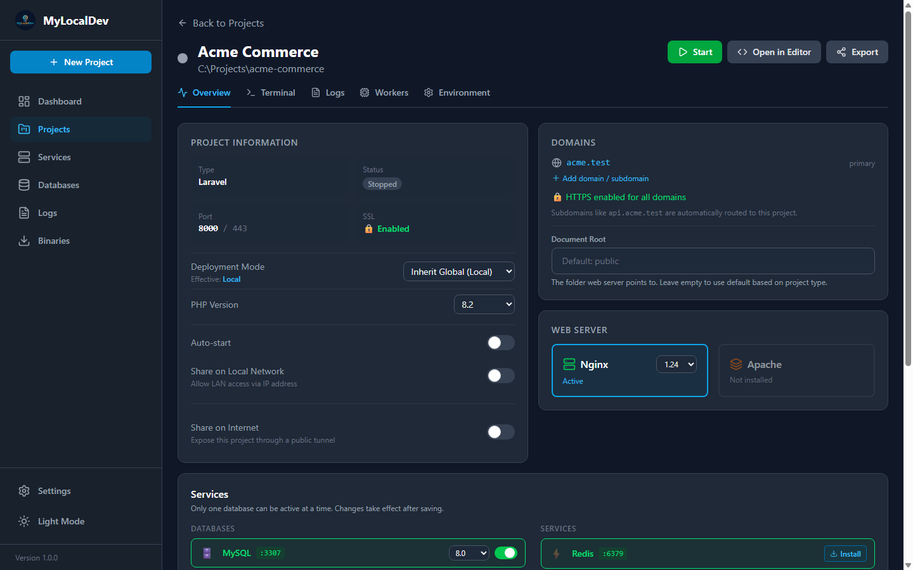
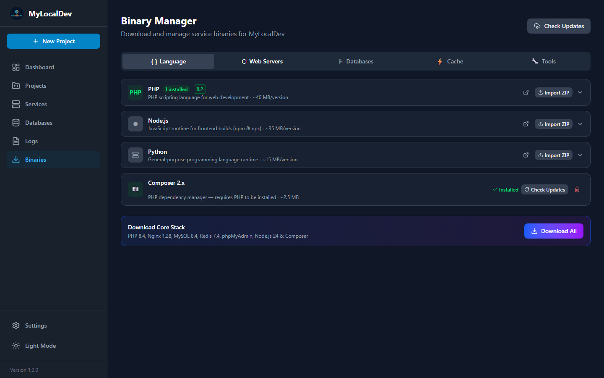
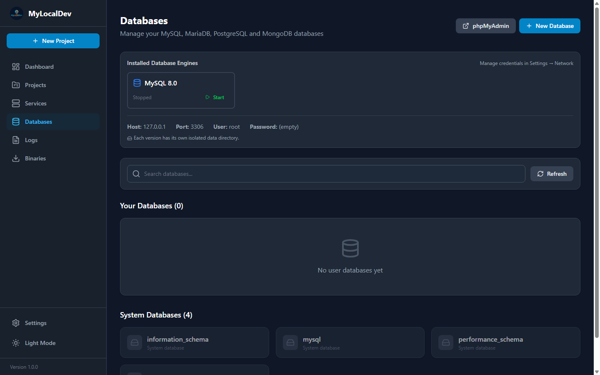
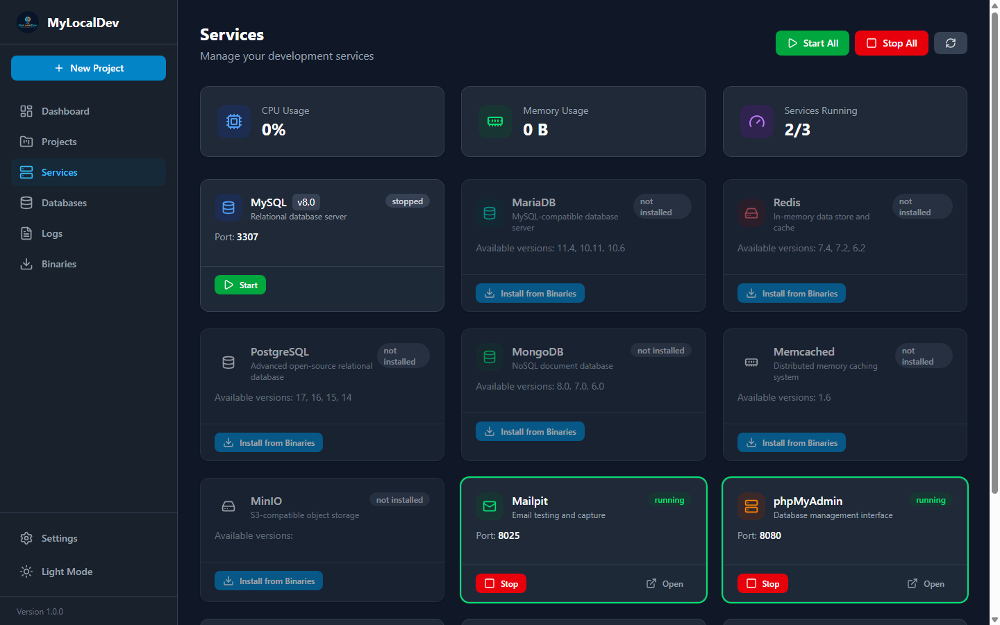
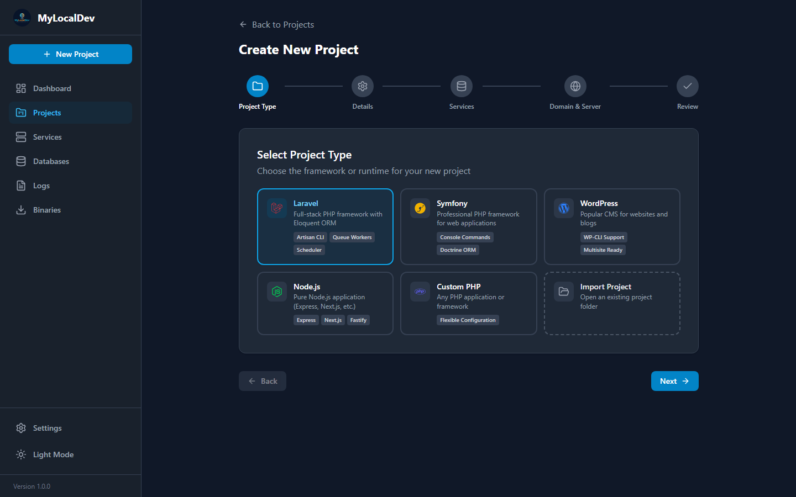

<p align="center">
  
</p>

<h1 align="center">MyLocalDev</h1>

<p align="center">
  <strong>Every version your projects need — side by side, without Docker.</strong><br>
  <sub>A Windows desktop app that owns your PHP, Node, database and web server runtimes so your projects don't have to share.</sub>
</p>

<p align="center">
  <a href="https://github.com/playpixelpro/mylocaldev/releases/latest">
    
  </a>
  
  
  
  
  
</p>

<p align="center">
  <a href="https://playpixelpro.github.io/mylocaldev/"><b>Website</b></a> ·
  <a href="https://github.com/playpixelpro/mylocaldev/releases/latest">Download</a> ·
  <a href="https://playpixelpro.github.io/mylocaldev/getting-started.html">Getting started</a> ·
  <a href="https://github.com/playpixelpro/mylocaldev/issues">Issues</a> ·
  <a href="#sponsor">Sponsor</a>
</p>

---

## Why MyLocalDev

- **Old and new projects at the same time.** Pin PHP 7.4 to the legacy client site and 8.5 to the rewrite; both keep running, neither notices the other.
- **Real domains instead of `localhost:8000`.** Projects answer on `name.test` with certificates your browser trusts.
- **No containers.** Runtimes live in a folder, not in an image. Xdebug, file watchers and breakpoints behave the way you expect.
- **Honest state.** Every screen shows which runtime, port, database and certificate a project is actually using.
- **Nothing forced on your machine.** PHP, Node and Composer are optional on the host — the app downloads and isolates what you install.

## Screenshots

| Dashboard | Project settings | Binary manager |
|:-:|:-:|:-:|
|  |  |  |
| **Databases** | **Services** | **Project wizard** |
|  |  |  |

## Features

**Projects**
- New project wizard for Laravel, Symfony, WordPress, plain PHP and Node.js frameworks
- Import an existing folder without rewriting it — the project's `.env` is read, not replaced
- Per-project PHP, Node, web server, database and deployment mode
- Start, stop and restart from one screen, with live status

**Domains & TLS**
- Automatic `.test` domains, hosts-file entries and virtual hosts
- Local certificate authority with one-click trust, wildcards for subdomains
- Nginx or Apache per project, with automatic front-door proxying

**Runtimes**
- PHP 7.4 – 8.5, Node.js 16 – 24, Python 3.10 – 3.13
- Nginx 1.24 – 1.28, Apache 2.4
- MySQL 5.7 – 8.4, MariaDB 10.6 – 11.4, PostgreSQL 14 – 17, MongoDB 6.0 – 8.0, SQLite
- Redis 6.2 – 7.4, Memcached 1.6, MinIO, Mailpit, phpMyAdmin, Composer, Git
- Download, import a ZIP, or update in place while keeping custom ini directives and extensions

**Databases**
- Versioned data directories and offset ports, so two MySQL builds can run together
- SQL and gzipped import/export with visible progress
- Databases created automatically per project, backed up next to the engine

**Environments & deployment**
- Local and production modes per project: OPcache + JIT, hardened headers, extra FastCGI workers
- Supervisor for queue workers with crash-loop protection and restart backoff
- Windows Task Scheduler integration for `artisan schedule:run`
- Environment editor that flags any value overriding `.env`

**Developer comfort**
- Folder-aware CLI: `php`, `composer`, `npm`, `mysql` resolve to the project you are in
- Built-in terminal, per-project and per-service logs
- Cloudflare Tunnel and zrok sharing for temporary previews
- Light and dark themes with a theme-aware logo

## Supported runtimes

| Category | Versions |
|---|---|
| PHP | 7.4 · 8.0 · 8.1 · 8.2 · 8.3 · 8.4 · 8.5 |
| Node.js | 16 · 18 · 20 · 22 · 24 |
| Python | 3.10 · 3.11 · 3.12 · 3.13 |
| Web servers | Nginx 1.24 · 1.26 · 1.28 — Apache 2.4 |
| Databases | MySQL 5.7 · 8.0 · 8.4 — MariaDB 10.6 · 10.11 · 11.4 — PostgreSQL 14–17 — MongoDB 6.0 · 7.0 · 8.0 — SQLite 3 |
| Cache & storage | Redis 6.2 · 7.2 · 7.4 — Memcached 1.6 — MinIO |
| Tooling | Composer · Git · phpMyAdmin · Mailpit |

See the [runtime reference](https://playpixelpro.github.io/mylocaldev/services.html) for default ports and how multiple versions coexist.

## Install

1. **Download** the latest release — `MyLocalDev-Setup-x.y.z.exe` (installer) or `MyLocalDev-x.y.z.exe` (portable).
2. **Add a runtime** from **Binaries**: a PHP build first, then whatever the project needs.
3. **Create or import a project** and pick its versions.
4. **Open the domain** shown on the project screen — e.g. `acme.test`.

No PHP, Node or Composer installation is required beforehand.

## Build from source

```bash
git clone https://github.com/playpixelpro/mylocaldev.git
cd mylocaldev
npm install
npm run dev            # Vite renderer + Electron
```

```bash
npm test               # Vitest (main + renderer)
npm run test:e2e       # Playwright against the built app
npm run build:renderer # renderer bundle only
npm run build:win      # installer + portable build
```

Requirements: Node.js 24+, npm, Git.

## Releasing

Releases are built and published by GitHub Actions when a version tag is pushed:

```bash
git tag v1.0.2
git push origin v1.0.2
```

The workflow builds on `windows-latest`, writes the tag's version into `package.json`, publishes
`MyLocalDev-Setup-x.y.z.exe`, the portable build and `latest.yml`, and applies
`release-notes/<version>.md` if the file exists. Manual runs build artifacts only.

## ❤️ Sponsor

MyLocalDev is free, MIT licensed and built in spare time. If it saves you a working day, sponsorship
covers maintenance, Windows testing and runtime download costs.

<p align="center">
  <a href="https://github.com/sponsors/playpixelpro">
    
  </a>
</p>

Sponsoring is optional — issues and well-described bug reports are just as valuable.

## Credits

MyLocalDev is a rebranded fork of **DevBox Pro**, originally created by **Jeffrey Gepiga** and released
under the MIT License. The original copyright is preserved in [LICENSE](LICENSE) and [NOTICE](NOTICE).

## License

[MIT](LICENSE) © 2026 PlayPixelPro. Original work © 2025 Jeffrey Gepiga.
